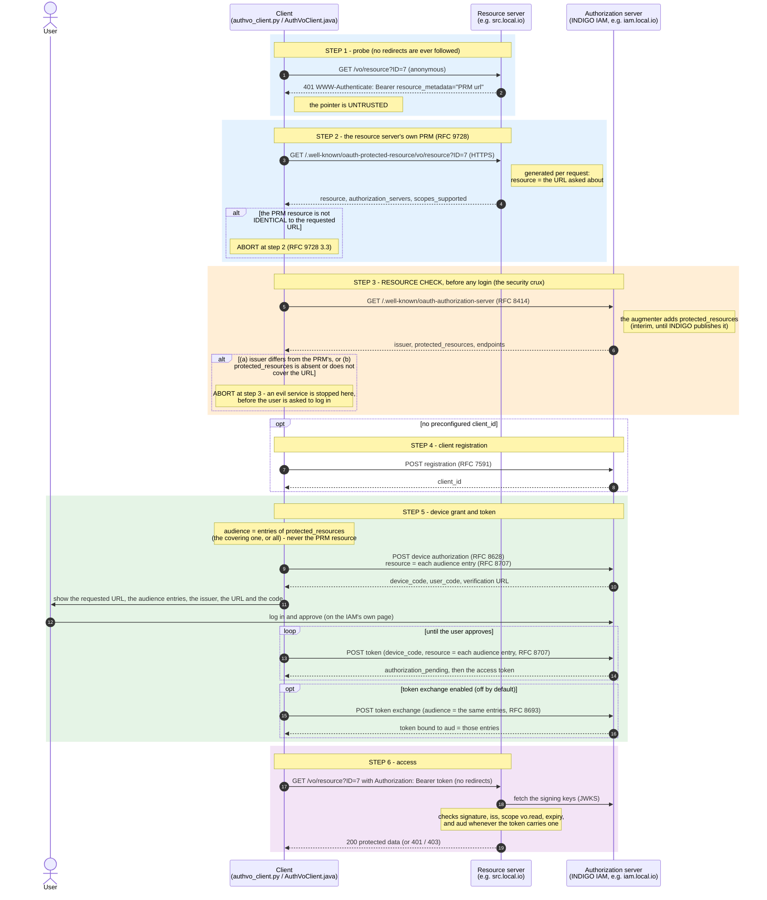

# AuthVO clients & local integration harness

Reference clients and a self-contained, `docker compose`–based test
environment for the **IVOA AuthVO bearer-token flow** — securing Virtual
Observatory data services with OAuth2/OIDC bearer tokens, using **INDIGO IAM**
as the authorization server.

This repository contains:

* two **reference client implementations** (Python and Java) of the AuthVO flow,
  which follows RFC 9728 with the departures listed in §15 (see §13 for what changed with
  [AuthVO issue #22](https://github.com/ivoa-std/AuthVO/issues/22)), and
* a **local integration harness** (`test-integration/`) that stands up a real
  INDIGO IAM, a metadata *augmenter* that emulates the one thing INDIGO does not
  yet publish, a single-origin Traefik proxy, a protected resource server, and an
  "evil" resource server for a negative test, plus runnable demo drivers and a
  live scenario runner.

---

## 1. Background — the problem AuthVO solves

Plain OAuth2 does not tell a client *which* resource server a freshly-issued
token may be sent to. A malicious resource server (the "evil service") can name a
**real** identity provider in its own metadata and so lure the user into
obtaining a real token for it, then capture that token.

The AuthVO direction (from the IVOA DSP *Bearer Tokens — Open Issues* deck, as
revised by issue #22) follows [RFC 9728](https://www.rfc-editor.org/rfc/rfc9728), with the
departures listed in §15:

* The resource server's `401` returns **only a pointer** (`resource_metadata`) to
  its **own** Protected Resource Metadata (PRM) document, which it publishes at
  its own well-known URL. The pointer is untrusted; the client only accepts a PRM
  whose `resource` is **identical to the URL it asked for**, query included
  (RFC 9728 §3.3). A service whose paths vary (TAP jobs, DataLink `?ID=`) therefore
  **generates the PRM per request**; nothing is registered per URL.
* But a resource server can say anything about itself, including "my issuer is
  the real IAM". So the binding is checked **from the other side**: the
  authorization server's own RFC 8414 metadata must name the same issuer **and
  list the resource in `protected_resources`**
  ([RFC 9728 §4](https://www.rfc-editor.org/rfc/rfc9728#section-4), where it is
  *optional*; the AuthVO draft makes it mandatory). Only the
  issuer can vouch for which resources it serves. **Coverage** (a path-segment prefix
  rule) applies only to these entries: an entry plus the URLs it covers form the
  *authentication domain*. If it publishes no such list
  the client refuses: **absence is a failure, not a pass.** This *resource check*
  happens before the user is asked to log in.
* The client uses the device grant and asks for the token's audience with
  [RFC 8707](https://www.rfc-editor.org/rfc/rfc8707) `resource` indicators, on the
  device authorization request **and** the token request. The audience comes from the
  **issuer's** `protected_resources` (at least the entry that covered the URL; optionally
  every entry), **never from the PRM `resource`**. A cooperating issuer can bind the
  token's `aud` to it. (RFC 8693 token exchange can
  narrow it further, but is optional and off by default.) The resource server
  enforces `iss`, `vo.read`, expiry and — whenever the token carries one — `aud`.

## 2. The flow

```
 1  GET the protected resource anonymously (no redirects)
    -> 401  WWW-Authenticate: Bearer resource_metadata="<PRM url>"   (UNTRUSTED pointer)
 2  GET the PRM at that pointer — the resource server's OWN RFC 9728 document —
    over HTTPS, no redirects.  ABORT unless the PRM `resource` is IDENTICAL to the
    requested URL, query included (RFC 9728 3.3).  No "covered by" relaxation.
 3  RESOURCE CHECK (abort before any login).  For an issuer named in the PRM, GET
    its RFC 8414 metadata (no redirects) and require
       (a) metadata `issuer`  ==  the issuer the PRM named
       (b) `protected_resources` present AND one entry COVERS the requested URL
           (coverage applies here only; any query of the URL is ignored)
    The first listed issuer that passes both is used.  OIDC discovery is used only
    to read endpoints, never to skip (b).
 4  Obtain a client_id (preconfigured, or dynamic registration RFC 7591)
 5  Device authorization (RFC 8628): the user logs in and approves on the IAM's own
    page (the client shows the requested URL, the audience entries AND the issuer);
    poll the token endpoint.  The AUDIENCE is taken from `protected_resources`, never
    from the PRM: resource=<entry> (RFC 8707 2) goes on the device authorization
    request AND on every token request, repeated for several entries
    (audience="covering": the entry that covered the URL, the default;
     audience="domain": every entry).
    [optional, off by default: RFC 8693 token exchange, with the same list]
 6  Access the resource with the token (RS verifies signature/iss/scope/expiry,
    and aud when present)
 7  (refresh would re-send the same `resource` — not implemented in the reference clients)
```

The same flow as a sequence diagram (GitHub renders this natively). Everything up to
and including step 3 happens **before the user is asked to log in**, which is why a failed
check costs the user nothing:



**Step 2 is an exact match** (RFC 9728 §3.3). The PRM `resource` must be identical to the
requested URL: scheme and host compared case-insensitively, the default port ignored, the
path as is apart from one trailing slash, and the **query byte for byte** (no re-ordering,
no re-encoding; `?` is not "no query"). A requested URL's fragment is dropped, since it is
never sent; a PRM `resource` with a fragment never matches. Dot-segments are *not*
resolved. A PRM that merely *covers* the URL (say `resource` = `https://src.local.io/vo`
for a request to `…/vo/resource`) is refused: scenario 8 in §10.

**"Covered"** (step 3b **only**) means: equal to the identifier, or the same
scheme, host and port with a path that extends it **at a path-segment
boundary**; any query or fragment of the requested URL is ignored.
`https://src.local.io/vo` covers `https://src.local.io/vo/tap/async/1` and
`…/vo/datalink?ID=7` but not `https://src.local.io/vocab`; a root identifier
(`https://src.local.io`) covers its whole origin. Dot-segments are resolved first, so
`/vo/../other` is not "under" `/vo`. Both clients are tested against the same vectors
(`test-integration/tests/coverage_vectors.json`: `covered`, `most_specific`, `exact`,
`indicator`).

**The audience** is requested for entries of the issuer's `protected_resources`, **not**
for the PRM `resource` and not for the dynamic deep URL the client started from. Why: the
PRM `resource` is the requested URL — it may carry a query, which RFC 8707 §2 says a
resource indicator should not contain (INDIGO IAM rejects such values) — and it comes from
the resource server, whereas the issuer's list names the services the issuer really
issues tokens for and it is the issuer that mints the token. The default, `audience="covering"`
(`AUTHVO_AUDIENCE=covering`), requests the entry that matched in 3(b) (the most specific one if
several match), which is what the draft requires at least. `audience="domain"`
(`AUTHVO_AUDIENCE=domain`) requests every entry, the covering one first, by **repeating**
the `resource` parameter (RFC 8707 §2) — a domain-wide token. Entries that are not valid
indicators (relative, or with a fragment) are skipped in `domain` mode; if the covering
entry itself is invalid the client aborts at step 3. `resource` goes on the device
authorization request *and* the token request (the device grant has no authorization
request, so the device authorization request is where the resource is first stated;
RFC 8707 §2.2 allows it on the token request for every grant type).

A warning for `audience="domain"`: an authorization server may narrow the audience (RFC 8707 §2 lets it), and
**INDIGO IAM 1.15 uses only the first repeated `resource` value** (§7.4), so the token it issues names the
covering entry only. The clients keep sending the standard repeated parameter and **log a `NOTE`** when a
JWT's `aud` does not name every entry they asked for; the token is then refused, by a resource server that
enforces `aud`, at the entries it does not name.

---

## 3. Repository layout

| Path | Role |
|------|------|
| `authvo_client.py` | Python reference client (the flow of §2) |
| `AuthVoClient.java` | Java reference client (JDK 11+, Jackson) — behaves identically |
| `pom.xml` | Java build |
| `Demo.java`, `demo.py` | Root-level copies of the simplest demo driver (`demo.py` just runs `test-integration/demo/demo.py`) |
| `test-integration/` | The runnable Docker harness (everything below lives here) |
| `test-integration/docker-compose.yml` | The whole stack behind Traefik |
| `test-integration/setup.sh` | One-shot: certs + keystore + Traefik config, brings it up, provisions |
| `test-integration/iam/iam.env` | INDIGO IAM configuration |
| `test-integration/iam/GenKeystore.java` | Generates the IAM JWK signing keystore (pure JDK) |
| `test-integration/iam/keys/keystore.jwks` | JWT signing key set, generated locally (see §7) |
| `test-integration/augmenter/` | **Metadata augmenter** (Python, stdlib): adds `protected_resources` to the IAM's metadata — an interim emulation (see §6) |
| `test-integration/augmenter/config/protected_resources.json` | The resource identifiers the augmenter publishes |
| `test-integration/traefik/traefik.yml` | Single-origin proxy + TLS |
| `test-integration/fake-rs/` | The protected resource server (Flask); **generates its PRM per request**; also the "evil" instance |
| `test-integration/seed/provision.sh` | Provisions the IAM: vo.read scope, login users, authvo-client |
| `test-integration/demo/demo.py` | Reference driver (interactive device flow) |
| `test-integration/demo/auto_demo.py` | Non-interactive driver (auto-approves the login) |
| `test-integration/demo/human_demo.py` | Guided driver (Python): explains and pauses on every step |
| `test-integration/demo/Demo.java`, `HumanDemo.java` | The same two drivers in Java (JDK-only, single file) |
| `test-integration/demo/authvo_checks.py` | The discovery checks shared by the Python demos |
| `test-integration/tests/` | Offline unit tests and the live scenario runner (see §10) |

---

## 4. Architecture of the harness


* The **resource server** publishes its own PRM; nothing about the resource lives
  on the IAM origin any more. What ties `src.local.io` to the IAM is the IAM's
  `protected_resources` list, which the **augmenter** adds to the two
  `/.well-known` metadata documents (Traefik sends exactly those paths to it, at
  higher priority; every other IAM path goes straight to the IAM).
* The augmenter is an **interim emulation**. INDIGO IAM does not publish
  `protected_resources` yet and is not modified. To a client the augmented
  metadata is indistinguishable from native support, so the augmenter (and its
  Traefik router) can simply be deleted once INDIGO publishes the member.
* `iam.local.io`, `src.local.io` and `evil.local.io` all resolve to `127.0.0.1`
  (via `/etc/hosts`) and are served by the same Traefik instance on `:443`.

---

## 5. Prerequisites

* Docker + Docker Compose.
* Add the hostnames to `/etc/hosts` (each on its own line):

  ```
  127.0.0.1  iam.local.io src.local.io evil.local.io
  ```

  (`evil.local.io` is needed only for the negative test; the scenario runner can
  work without it, see §10.)

* Trust the generated CA (`test-integration/certs/local-ca.pem`) in your browser
  if you want to use the IAM web UI. On macOS:

  ```bash
  sudo security add-trusted-cert -d -r trustRoot \
    -k /Library/Keychains/System.keychain test-integration/certs/local-ca.pem
  ```

* Python 3 with `requests` for the Python client and demo drivers
  (`REQUESTS_CA_BUNDLE=test-integration/certs/local-ca.pem` makes the client trust
  the local CA). The Java client needs JDK 11+ and Jackson (see `pom.xml`).

> **Note on the IAM image.** The harness pins
> `indigoiam/iam-login-service:v1.15.0`, the release planned for production. It is an `amd64`
> image, so it runs under emulation on Apple Silicon (slower first boot). Env var names, profiles
> and the bootstrap mechanism move between INDIGO releases — §7 documents exactly what the pinned
> release needs, and what v1.10.0 (the earlier pin) did differently.

---

## 6. The PRM and the metadata augmenter

Two documents carry the discovery, and **they come from different parties**:

| Document | Published by | Says | Checked in |
|----------|--------------|------|-----------|
| PRM (RFC 9728) at `https://src.local.io/.well-known/oauth-protected-resource/<path>[?<query>]`, **one per requested URL** | the **resource server** | "for *this URL* I am this resource; these issuers sign my tokens" | step 2 |
| AS metadata (RFC 8414) at `https://iam.local.io/.well-known/oauth-authorization-server` | the **authorization server** | "these are the resources I serve" (`protected_resources`) | step 3 |

### 6.1 The PRM (generated per request by `fake-rs`)

A service whose paths vary — TAP async jobs (`/vo/tap/async/<id>`), DataLink
(`/vo/datalink?ID=…`) — cannot publish one static PRM file, and RFC 9728 §3.3 requires the
PRM's `resource` to be *identical* to the URL the client requested. So `fake-rs/app.py`
has **one handler** for `/.well-known/oauth-protected-resource/<path>` that answers every URL
the service owns, with the same members each time and `resource` set to the URL it was
asked about. There is no static file and **nothing is registered per URL**: the IAM still
lists one identifier per service in `protected_resources`.

```json
{
  "resource": "https://src.local.io/vo/datalink?ID=ivo%3A%2F%2Fsrc.local.io%2Fobs%3Fid%3D42",
  "authorization_servers": ["https://iam.local.io/"],
  "scopes_supported": ["vo.read"],
  "bearer_methods_supported": ["header"]
}
```

| Field | From | Meaning |
|-------|------|---------|
| `resource` | the **requested URL** | Rebuilt as `scheme://host` + `/<suffix>` + `?<query>` (RFC 9728 §3.1: the well-known suffix is *inserted between host and path*, and the query stays at the end). The query is kept **byte for byte**, percent-encoding included (the handler reads the raw request target). The JSON is built with `json.dumps`, so a query with quotes is escaped safely. |
| `authorization_servers` | `RS_ISSUER` | Issuer(s) the resource accepts tokens from. The client trusts one **only after** the resource check. |
| `scopes_supported` | `RS_REQUIRED_SCOPE` | Scopes the resource understands. |
| `bearer_methods_supported` | — | `header` = `Authorization: Bearer`. |

Configuration (all environment variables):

| Variable | Default | Meaning |
|----------|---------|---------|
| `RS_RESOURCE_ID` | `https://src.local.io` | The **service identifier** — what the IAM lists in `protected_resources` for this service (`https://src.local.io/vo` in the harness). Its origin is the origin of every URL the server answers for. |
| `RS_SERVICE_PATH` | the path of `RS_RESOURCE_ID` (else `/`) | The path this service **owns**, at a path-segment boundary: `/vo` owns `/vo` and `/vo/tap` but not `/vocab`. Anything else — a protected URL *or its PRM* — answers `404`, so the handler never claims URLs that belong to another tenant on a shared host. |
| `RS_AUDIENCE_IDS` | `RS_RESOURCE_ID` | Space-separated identifiers a token's `aud` may name (§9). List several to accept domain-wide tokens. |

The **401 challenge** points at the PRM *for the request*: the well-known URL derived from the
URL that was asked, query included. The old fixed `RS_PRM_URL` is gone.

### 6.1.1 Shared-host routing

Several services can share one host (`src.local.io` here). Each one needs its own
protected paths **and** its own well-known prefix routed to it, otherwise the PRM request
for `/vo/...` lands on the wrong service. In the harness (`docker-compose.yml`):

```yaml
- "traefik.http.routers.rs.rule=Host(`src.local.io`) && (PathPrefix(`/vo`) || PathPrefix(`/.well-known/oauth-protected-resource/vo`))"
```

(The draft's note says the same from the other side: on a shared host, list per-service path prefixes,
never an identifier covering the whole host, or one tenant's token could be presented to another's
services.) A second service (say DataLink on `https://src.local.io/datalink`) would add its own router
for `PathPrefix(`/datalink`)` and `PathPrefix(`/.well-known/oauth-protected-resource/datalink`)`,
and be listed in `protected_resources` too. (`PathPrefix` is a *string* prefix, so the router
also sends `/vocab` to this service; the service then answers `404` for it, because it owns
paths by segment boundary — which is why `RS_SERVICE_PATH` matters.) The harness lists a second entry,
`https://src.local.io/datalink`, in the IAM's metadata but does **not** serve it: it exists so the
tests show that only one entry has to cover the request, and so the `domain` audience has
something to request.

### 6.2 The metadata augmenter (`augmenter/app.py`)

A small stdlib-Python reverse proxy. It fetches the IAM's **live** metadata over
the internal network, adds one member, and returns everything else unchanged
(above all `issuer`):

```json
"protected_resources": ["https://src.local.io/vo", "https://src.local.io/datalink"]
```

* The list comes from `augmenter/config/protected_resources.json` and is read on
  **every request**, so an edit takes effect at once. The IAM's own metadata is
  cached for ~60 s (`AUGMENTER_CACHE_SECONDS`).
* If the IAM has no RFC 8414 document, one is derived from its OIDC discovery
  document.
* If the upstream document already contains `protected_resources`, it is left
  alone — native support wins.
* If the config file is missing or unreadable the member is **omitted**, which a
  client treats as a failure (it fails closed).

> **This is the interim emulation described in the AuthVO draft's implementation
> note. Delete the `augmenter` service and its Traefik router as soon as INDIGO IAM
> publishes `protected_resources` natively.**

> The demo wires this up for you. For a **real deployment** — how an operator makes
> their own IAM publish `protected_resources` — see §14.

### 6.3 Routing on the IAM origin (Traefik)

The augmenter answers exactly the two metadata paths, with a **higher router
priority** than the IAM, so those paths win on the shared `iam.local.io` origin:

```yaml
labels:
  - "traefik.enable=true"
  - "traefik.http.routers.augmenter.rule=Host(`iam.local.io`) && (Path(`/.well-known/oauth-authorization-server`) || Path(`/.well-known/openid-configuration`))"
  - "traefik.http.routers.augmenter.entrypoints=websecure"
  - "traefik.http.routers.augmenter.tls=true"
  - "traefik.http.routers.augmenter.priority=100"     # IAM router is priority 1
  - "traefik.http.services.augmenter.loadbalancer.server.port=8080"
```

### 6.4 The "evil" resource server

`evil.local.io` is a second `fake-rs` instance. Its 401 points at its own,
perfectly well-formed PRM (generated for the requested URL, so it passes the exact match
of step 2), which **names the real IAM** as its authorization
server — exactly the attack — but `https://evil.local.io` is not in the IAM's
`protected_resources`. Every client must therefore abort at the resource check,
before registration or any login. Its payload reads "EVIL SERVICE" so a leak
would be obvious.

---

## 7. INDIGO IAM — required configuration & provisioning

A stock `indigoiam/iam-login-service:v1.15.0` started with the production-style
`mysql` profile does **not** come up ready out of the box. The following changes
are what make the flow work end to end. They live in `iam/iam.env` and
`docker-compose.yml`.

### 7.1 `iam/iam.env` changes

```properties
# 1. Flyway bundles migrations for several DB vendors under db/migration/{h2,mysql,...}.
#    Pin to the mysql set, or it finds two "V1" migrations and aborts at boot.
SPRING_FLYWAY_LOCATIONS=classpath:db/migration/mysql

# 2. The IAM_DB_* names were NOT honored by v1.10.0 — it fell back to embedded H2
#    and ran the MySQL migrations against it (syntax error). Drive the datasource
#    with the standard Spring Boot properties so it connects to MariaDB (v1.15.0
#    was only run this way).
SPRING_DATASOURCE_URL=jdbc:mysql://db:3306/iam
SPRING_DATASOURCE_USERNAME=iam
SPRING_DATASOURCE_PASSWORD=pwd
SPRING_DATASOURCE_DRIVER_CLASS_NAME=com.mysql.cj.jdbc.Driver

# 3. The IAM ships NO signing keystore; the app won't start without one.
#    Generate a JWK set (see 7.2) and point the IAM at it.
IAM_KEY_STORE_LOCATION=file:/keystore.jwks

# 3b. v1.15 only creates the keystore bean under the `prod` profile; without it the
#    IAM stops at start-up ("No qualifying bean of type JwkKeyStore"). v1.10.0 did not
#    need it.
IAM_JAVA_OPTS=-Dspring.profiles.active=mysql,registration,prod -Djava.security.egd=file:/dev/./urandom

# 4. Put the granted scopes INTO the JWT access token (default is false) so the
#    resource server can enforce vo.read from the token itself.
IAM_ACCESS_TOKEN_INCLUDE_SCOPE=true
```

### 7.2 Generate the JWT signing keystore

INDIGO expects a JWK **set** (JSON) whose `kid` matches `IAM_JWK_DEFAULT_KEY_ID`
(default `rsa1`). Generate one and mount it at `/keystore.jwks`:

```python
import json, base64
from cryptography.hazmat.primitives.asymmetric import rsa

def b64u(i):
    b = i.to_bytes((i.bit_length() + 7) // 8, "big")
    return base64.urlsafe_b64encode(b).rstrip(b"=").decode()

k = rsa.generate_private_key(public_exponent=65537, key_size=2048)
pub, pri = k.public_key().public_numbers(), k.private_numbers()
jwk = {"kty": "RSA", "kid": "rsa1", "use": "sig", "alg": "RS256",
       "n": b64u(pub.n), "e": b64u(pub.e), "d": b64u(pri.d),
       "p": b64u(pri.p), "q": b64u(pri.q),
       "dp": b64u(pri.dmp1), "dq": b64u(pri.dmq1), "qi": b64u(pri.iqmp)}
json.dump({"keys": [jwk]}, open("iam/keys/keystore.jwks", "w"), indent=2)
```

```yaml
# docker-compose.yml (iam service)
volumes:
  - ./iam/keys/keystore.jwks:/keystore.jwks:ro
```

### 7.3 Provision the empty database

Under the `mysql` profile the schema is created but **no seed data** is loaded —
no users, no clients, the custom `vo.read` scope does not exist. `setup.sh` runs
[`seed/provision.sh`](test-integration/seed/provision.sh) to do all of this
automatically (idempotently); the SQL below is what that script does, for
reference.

**a) A login user** (the device grant needs a real account). INDIGO stores a
bcrypt password and uses a `DTYPE='IamUserInfo'` discriminator on `iam_user_info`:

```sql
INSERT INTO iam_authority(auth) VALUES ('ROLE_USER'),('ROLE_ADMIN');  -- if absent
INSERT INTO iam_user_info(EMAIL,EMAILVERIFIED,FAMILYNAME,GIVENNAME,DTYPE)
  VALUES ('vouser@local.io',1,'User','Vo','IamUserInfo');
INSERT INTO iam_account(active,CREATIONTIME,LASTUPDATETIME,PASSWORD,USERNAME,UUID,user_info_id,provisioned)
  VALUES (1,NOW(),NOW(),'<bcrypt-hash>','vouser','<uuid>',LAST_INSERT_ID(),0);
-- then link the account to ROLE_USER in iam_account_authority
```

Generate the bcrypt hash with `htpasswd -bnBC 10 "" <password>` (normalize the
`$2y$` prefix to `$2a$`). The harness creates `admin`/`password` (admin) and
`vouser`/`vouser` (user).

**b) The `vo.read` system scope:**

```sql
INSERT INTO system_scope(scope,description,restricted,default_scope,structured)
  VALUES ('vo.read','Read access to VO protected resources',0,0,0);
```

**c) An OAuth client** — only needed by `demo.py`/`auto_demo.py` and the scenario
runner, which read a preconfigured `client_id` from `seed/client_id`.
`human_demo.py` registers its own client at runtime instead. To create a friendly
`client_id` (DCR generates a random one), register via DCR then rename it and add
the token-exchange grant (which the clients only use when token exchange is
switched on, §7.4):

```sql
UPDATE client_details SET client_id='authvo-client' WHERE client_id='<generated>';
INSERT INTO client_grant_type(owner_id, grant_type)
  SELECT id,'urn:ietf:params:oauth:grant-type:token-exchange'
  FROM client_details WHERE client_id='authvo-client';
```

### 7.4 Audience binding, and the token-exchange restriction

The clients ask for audience binding with the RFC 8707 **`resource`** parameter on
the device authorization request **and** the device-grant token request — once per
`protected_resources` entry they want in the audience (§2) — and stop there: RFC 8693 token exchange is
**optional and off by default** (`AuthVoClient(token_exchange=True)`,
`AUTHVO_TOKEN_EXCHANGE=1`, or `--token-exchange` on the demos). Whether the JWT
that comes back carries an `aud` is up to the issuer — which is why the resource
server enforces `aud` **whenever the token has one** (it must include the
resource) without *requiring* one; the signature, `iss`, `vo.read` and expiry are
always checked.

> **Observed with the pinned INDIGO IAM v1.15.0:** it honours the `resource` parameter —
> the access token's `aud` is set from it (a single value; with several, the first only, see below),
> so against INDIGO 1.15 the flow gives an audience-restricted token without the token exchange
> (the clients log `aud=https://src.local.io/vo`). The earlier pin, **v1.10.0, ignored** `resource` and
> issued tokens with no `aud`, so there the token was not audience-bound unless the **optional token
> exchange** was used (scenario 1c in §10: the exchanged token carries `aud=https://src.local.io/vo`,
> on both releases). Without an `aud` a resource server cannot tell a token minted for it from one
> minted for another service this issuer serves. Clients log the token's `aud` for information only
> and never fail on it. (Earlier versions of `human_demo` used INDIGO's non-standard `aud` request
> parameter; that is gone — the clients send `resource` only.)

> **Measured — several `resource` parameters** (scenario 9 in §10), on two INDIGO releases.
> The clients, run with `AUTHVO_AUDIENCE=domain`, send `resource=https://src.local.io/vo` **and**
> `resource=https://src.local.io/datalink` on the device authorization request and on every token
> poll. Direct probes with the same user and client show what each IAM does with them:
>
> | `resource` sent | v1.10.0 | v1.15.0 |
> |-----------------|---------|---------|
> | none | no `aud` | no `aud` |
> | one listed value | no `aud` (ignored) | `aud` = that value |
> | `[service, datalink]` (the clients' order) | no `aud` | `aud` = **`service` only** |
> | `[datalink, service]` (reversed) | no `aud` | `aud` = **`datalink` only** |
> | `[service, datalink, unlisted]` | no `aud` | `aud` = `service` only |
> | one value **not** in `protected_resources` | token issued, no `aud` | token issued, **`aud` = that unlisted value** (no `invalid_target`) |
> | one value **with a query** | accepted, ignored | device authorization accepted, then the consent page fails with `invalid_target`: *"The resource indicator contains a query component"* — no token |
> | **one space-separated value** `"service datalink"` (not RFC 8707; measured only, the clients never send it) | no `aud` | `aud` = **both**, as a list |
>
> So **v1.10.0 ignores `resource`**, repeated or not, and issues no `aud`. **v1.15.0 honours it but uses only the
> *first* repeated value** (the order decides which), so `audience="domain"` does **not** yield a domain-wide token from
> INDIGO 1.15: the covering entry is sent first, so the token is audience-restricted to the covering entry, as
> with `audience="covering"`. Only a single space-separated value gave a multi-entry `aud`; that is not what RFC 8707
> specifies and the clients do not send it (a client option for IAMs that need it would be a separate decision).
> Two more facts from the same probes: v1.15.0 does **not** reject an unlisted resource (the draft's "SHOULD
> `invalid_target`"; the Step 3 check stays the only protection), and it **does** reject a resource carrying a query,
> which is why the audience must never be taken from the PRM `resource`. Releases between 1.10 and 1.15 were not tested.
>
> *To repeat this on another release* (the harness is pinned to v1.15.0; this is how v1.10.0 was measured): run the stack as a separate
> Compose project with an override that sets the `iam` image and, since the `prod` profile is not needed (and
> harmless to drop) on 1.10, its `IAM_JAVA_OPTS`, e.g.
> `COMPOSE_FILE=docker-compose.yml COMPOSE_PROJECT_NAME=iam110 docker compose -f docker-compose.yml -f override.yml up -d`,
> then `./seed/provision.sh` and `python tests/run_scenarios.py --only 0,9`. Provisioning and every scenario
> (0–9, both clients) ran unchanged against both releases.

`DefaultClientRegistrationService` hard-codes
`FORBIDDEN_GRANT_TYPES_FOR_ANONYMOUS` to include `token-exchange` and
`password`. A **self-registered** (RFC 7591) client therefore **cannot** request
the token-exchange grant — there is no env toggle for this. Consequently:

* By default every client, including a purely self-registered one, completes the
  flow with the `resource` indicator alone, and dynamic registration asks only for
  the device-code grant.
* To use token exchange as well, use a **preconfigured** client that was given the
  grant (`provision.sh` does this for `authvo-client`) and switch it on.

---

## 8. TLS / certificates

`setup.sh` generates a local CA and a leaf certificate for `iam.local.io`,
`src.local.io` and `evil.local.io`. The CA is created once and kept; only the
**leaf** is re-issued if it lacks a name (e.g. it predates `evil.local.io`), so a
CA you already trust stays valid. Modern OpenSSL 3
(used by Python 3.11+) **rejects a CA without the proper X.509 extensions**
(`CA cert does not include key usage extension`), so the CA and leaf are issued
with explicit extensions:

```bash
# CA
openssl req -x509 -nodes -newkey rsa:2048 -days 825 \
  -keyout certs/local-ca.key -out certs/local-ca.pem -subj "/CN=AuthVO Local Test CA" \
  -addext "basicConstraints=critical,CA:TRUE" \
  -addext "keyUsage=critical,keyCertSign,cRLSign"

# leaf extensions (certs/san.ext)
basicConstraints = CA:FALSE
keyUsage = digitalSignature, keyEncipherment
extendedKeyUsage = serverAuth
subjectAltName = DNS:iam.local.io, DNS:src.local.io, DNS:evil.local.io
```

---

## 9. The resource server (`fake-rs/`)

A small Flask service standing in for a TAP/DataLink/SODA endpoint.

* Unauthenticated `GET /vo/resource` (or any URL below `RS_SERVICE_PATH`, with or without a
  query: `/vo/tap/async/<id>`, `/vo/datalink?ID=…`) → `401` with
  `WWW-Authenticate: Bearer resource_metadata="<the PRM URL for THAT request>"`.
* `GET /.well-known/oauth-protected-resource/<path>[?<query>]` → the **PRM generated for
  that URL** (§6.1); `404` outside the service path.
* With a Bearer token it verifies, before returning anything: signature against
  the IAM JWKS, `iss == IAM`, scope contains **`vo.read`**, not expired, and — if
  the token carries an `aud` — that it **includes an identifier from `RS_AUDIENCE_IDS`
  that covers the request URL** (so a domain-wide token naming several entries is accepted
  while a token for an unrelated service is not).
* Valid → `200` with the payload (`protected_resource.txt`).
* Missing scope → `403 insufficient_scope`; bad/expired/wrong-aud → `401`.
* With `RS_TEST_FAULTS=1` (on for the harness's `src` instance) it also serves three
  deliberately broken discovery set-ups used by the negative scenarios, under the service path:
  `/vo/faults/prm-not-covering/resource` (its PRM describes a different resource),
  `/vo/faults/prm-covering/resource` (its PRM names the service identifier, which *covers* the
  URL but is not equal to it — what the pre-review profile accepted) and
  `/vo/faults/prm-redirect/resource` (its PRM URL redirects to a good PRM).

The validation logic is covered by `tests/test_fake_rs.py`: the six token cases — valid,
wrong audience, missing scope, rogue issuer, expired, unauthenticated — plus `aud` present/absent
and with several entries, the PRM for a path and for a query (including characters that need JSON
escaping and byte-exact percent-encoding), the `404` outside the service path, the pointer derived
from the requested URL, and the fixtures.

Two harness fixes worth noting:

* The pinned **PyJWT 2.7.0** `PyJWKClient` fetches the JWKS via `urllib`, which
  ignores the app's `requests` CA bundle. Point urllib's default TLS context at
  the CA with `SSL_CERT_FILE=/certs/local-ca.pem` on the service.
* The payload file is mounted (`./fake-rs/protected_resource.txt`) so editing it
  needs only a `docker compose up -d resource`, not an image rebuild.

---

## 10. Running it

```bash
cd test-integration
./setup.sh            # certs + keystore + Traefik config + up + provision (idempotent)
```

`setup.sh` reproduces the whole working stack in one shot: it generates the CA and
leaf certs (with the X.509 extensions OpenSSL 3 requires, §8) and the IAM signing
keystore (§7.2), starts the stack, then runs `seed/provision.sh` to create the
`vo.read` scope, the login users (`admin`/`password`, `vouser`/`vouser`) and the
`authvo-client` (§7.3). It is safe to re-run.

> **A `docker-compose.override.yml` is merged automatically.** If you keep one in
> `test-integration/` (say, to remap the proxy to `:8443` so the stack can coexist
> with another one holding `:443`), `docker compose` picks it up without being
> asked — but the scripts, the demos and the scenario runner all use
> `https://iam.local.io/` on `:443`. Skip the override with
> `COMPOSE_FILE=docker-compose.yml ./setup.sh` (and for any `docker compose`
> command), or rename the file while you don't need it. While it waits for the IAM,
> `provision.sh` prints a **diagnosis** every ~30 s (what each URL answers, which
> port Traefik is really on, whether the IAM was OOM-killed, …), so a stall says why.

### The demo drivers

Run any of them from `test-integration/demo/`:

```bash
# Reference driver — you complete the device login in a browser.
python demo.py --resource https://src.local.io/vo/resource \
  --cacert ../certs/local-ca.pem --client-id-file ../seed/client_id

# Non-interactive — auto-approves the device login as the given user.
python auto_demo.py --username vouser --password vouser

# Guided — explains and pauses on every step (including WHY each check exists);
# the client self-registers (RFC 7591), you log in and approve on the IAM's page.
python human_demo.py

# Same guided flow in Java, no build step (JDK 11+):
java HumanDemo.java
```

Add `--token-exchange` to `demo.py`/`auto_demo.py` to also run RFC 8693 exchange, and
`--audience domain` to any driver to request every entry of the IAM's `protected_resources`
instead of only the one covering the URL. `human_demo.py` / `HumanDemo.java` explain, in plain
words, why the PRM must name the exact URL and why the audience comes from the IAM's list.
On success the resource returns the protected payload (an ASCII galaxy here).

### The reference clients

```bash
export REQUESTS_CA_BUNDLE=test-integration/certs/local-ca.pem
AUTHVO_CLIENT_ID=$(cat test-integration/seed/client_id) \
  python authvo_client.py https://src.local.io/vo/resource

# Java: needs Jackson (core, annotations, databind) on the classpath, see pom.xml.
javac -d out -cp "$JACKSON" AuthVoClient.java
keytool -importcert -noprompt -alias authvo-local -file test-integration/certs/local-ca.pem \
  -keystore ca.jks -storepass changeit
AUTHVO_CLIENT_ID=$(cat test-integration/seed/client_id) \
  java -Djavax.net.ssl.trustStore=ca.jks -Djavax.net.ssl.trustStorePassword=changeit \
       -cp "out:$JACKSON" org.ivoa.authvo.AuthVoClient https://src.local.io/vo/resource
```

Both exit `0` only if the resource returns `200`, `1` on a failed check / network
error / any other status. Set `AUTHVO_TOKEN_EXCHANGE=1` to also exchange the token, and
`AUTHVO_AUDIENCE=domain` (default `covering`) to request every `protected_resources` entry
(an unknown value is a usage error, exit `2`).

### Tests

*Offline* (no Docker needed):

```bash
pip install requests flask "pyjwt[crypto]==2.7.0"
python -m unittest discover -s test-integration/tests -p "test_*.py" -v

# Java: the client (steps 1-3, stubbed HTTP) and the demos' helper copies
javac -d out -cp "$JACKSON" AuthVoClient.java test-integration/tests/ClientOfflineTest.java
java  -cp "out:$JACKSON" org.ivoa.authvo.ClientOfflineTest test-integration/tests/coverage_vectors.json
javac -d out2 test-integration/demo/Demo.java test-integration/demo/HumanDemo.java test-integration/tests/DemoHelpersTest.java
java  -cp out2 DemoHelpersTest test-integration/tests/coverage_vectors.json
```

*Live scenarios* — the real clients against the running stack, with the device
login auto-approved:

```bash
python test-integration/tests/run_scenarios.py --java-cp "$JACKSON"
```

| # | Scenario | Expected |
|---|----------|----------|
| 0 | preflight | a PRM generated per request (also for a query, byte for byte), `404` outside the service, the augmented metadata with both entries, no PRM sidecar |
| 1 | happy path (1: preconfigured client, 1b: dynamic registration, 1c: with the optional token exchange on), Python and Java | protected payload returned (1c: the exchanged token carries `aud=https://src.local.io/vo`) |
| 2 | evil resource server (`evil.local.io`) | abort at the resource check, before any login |
| 3 | `protected_resources` removed from the augmenter config | abort at the resource check |
| 4 | PRM `resource` is a different resource | abort at step 2 |
| 5 | the PRM URL redirects | abort — redirects are never followed |
| 6 | resource server's token-validation, PRM and routing cases | unit tests pass |
| 7 | variable paths: `/vo/tap/async/<random>` and a URL with a query | a PRM is generated for each, step 2 (exact match) passes, the token is requested for `https://src.local.io/vo` only (never the URL or its query) |
| 8 | PRM whose `resource` **covers** the requested URL but is not equal to it (`/vo/faults/prm-covering/resource`) | abort at step 2, before any login |
| 9 | `AUTHVO_AUDIENCE=domain` | **a measurement, not pass/fail**: what the IAM issues for several `resource` parameters, in different orders, with an unlisted value, with a query, and (to measure only) one space-separated value (§7.4). The IAM version is printed from the running container |

Every abort scenario also asserts the client stopped **before** registration and
the device grant. If `evil.local.io` is not in `/etc/hosts` the runner maps it for
the client processes only.

---

## 11. Troubleshooting

| Symptom | Cause / fix |
|---------|-------------|
| IAM exits: *Found more than one migration with version 1* | Flyway scanning both vendor dirs — set `SPRING_FLYWAY_LOCATIONS=classpath:db/migration/mysql`. |
| IAM exits: H2 syntax error on `token_value(767)` | Datasource fell back to H2 — set the `SPRING_DATASOURCE_*` properties. |
| IAM exits: *Key Set resource could not be read: keystore.jwks* | No signing keystore — generate one (§7.2) and set `IAM_KEY_STORE_LOCATION`. |
| Client aborts: *check (b): the issuer publishes no protected_resources* | The augmenter isn't answering the metadata paths (Traefik hasn't registered it — retry or restart the proxy) or its config is empty. Check `curl --cacert test-integration/certs/local-ca.pem https://iam.local.io/.well-known/oauth-authorization-server \| jq .protected_resources` (§6.2). |
| Client aborts: *STEP 2 FAILED … is not identical to the requested URL* | The PRM's `resource` is not exactly the URL you asked for, query included (§2, RFC 9728 §3.3). A static PRM, or one for the service identifier, cannot pass: the server must generate the PRM per request (§6.1). |
| Client aborts: *refusing to follow redirects* | A discovery URL answered 3xx. Clients never follow redirects; fix the URL (the PRM pointer, the issuer in the PRM). |
| Client aborts: *check (a): metadata issuer … != the issuer named by the PRM* | `RS_ISSUER` and the IAM's `IAM_ISSUER` differ (mind the trailing slash). |
| Clients abort with *the issuer publishes no protected_resources* although `augmenter/config/protected_resources.json` has content, and `docker exec <augmenter> ls /config` shows nothing | A **stale directory bind mount**: the host directory was deleted and re-created while the stack was up (typically by `git checkout` to a commit without `augmenter/`, or `git clean`), and the container still points at the old, deleted one. `docker compose up -d --force-recreate augmenter`. |
| `augmenter` returns `502` | The IAM isn't up yet (or is down); it proxies the IAM's live metadata. |
| `evil.local.io` doesn't resolve / TLS error for it | Add it to `/etc/hosts` (§5); re-run `./setup.sh` so the leaf certificate covers it. |
| Client TLS: *CA cert does not include key usage extension* | Regenerate certs with the X.509 extensions (§8). |
| RS `401 invalid_token`, `PyJWKClientConnectionError` | JWKS fetch can't verify TLS — set `SSL_CERT_FILE` on the resource (§9). |
| RS `403 insufficient_scope` | Token has no `scope` claim — set `IAM_ACCESS_TOKEN_INCLUDE_SCOPE=true`. |
| DCR: *Grant type not allowed: ...token-exchange* | Self-registration can't request token-exchange. It is off by default now; leave it off or use a preconfigured client (§7.4). |
| `./setup.sh` sits at *waiting for IAM* although `docker compose logs iam` says *Started IamLoginService* | The proxy is published on a port other than 443 — typically because a `docker-compose.override.yml` remapping it (e.g. `8443:443`) was merged automatically. `provision.sh` now says so in its diagnosis. Re-run with `COMPOSE_FILE=docker-compose.yml ./setup.sh` (§10). |
| `curl: (22) … 404` on client registration, or every IAM path (even `/login`) answers a bare `404 page not found` while the discovery document works | Traefik has not registered the IAM's router (a start-up race when the proxy and the IAM are recreated together; the discovery document is a different router, served by the augmenter). `docker compose restart proxy`, then re-run `./setup.sh`. `provision.sh` now waits for `/login` as well and retries registration. |
| `seed/provision.sh` times out after ~7.5 min with `IAM did not come up`, later demos get `404` instead of `401` | Host port 443 is already taken by something else, so the `proxy` (Traefik) service fails to start (`Bind for 0.0.0.0:443 failed: port is already allocated`) while the rest of the stack comes up fine — nothing is actually fronting `iam.local.io`/`src.local.io`, so discovery never succeeds and unrelated requests land wherever else 443 is bound. Check with `docker ps --format "{{.Names}}\t{{.Ports}}" \| grep 443` / `sudo lsof -iTCP:443 -sTCP:LISTEN`, free the port (or remap the `proxy` service's port and the IAM's `IAM_ISSUER`/`IAM_BASE_URL` via a `docker-compose.override.yml`), then re-run `./setup.sh`. |

---

## 12. Security notes

* This harness uses self-signed certs, throwaway passwords, and a public
  (`token_endpoint_auth_method: none`) client. It is for **local testing only**.
* The security argument rests on the **resource check** (step 3): the issuer's own
  metadata must name the same issuer *and* list the resource, and an absent list is
  a failure. It does **not** rest on where any document is hosted. (The augmenter
  sits on the IAM origin only because that is where the IAM's metadata is served;
  being interim, it is the part to delete when INDIGO publishes the member.)
* No discovery request, and no request carrying a bearer token, ever follows a
  redirect.
* The resource server validates the token server-side (signature, `iss`, scope,
  expiry, and `aud` when present). The client's checks are what stop it from
  sending the user to log in, and a token to be minted, for a spoofed resource in
  the first place.

---

## 13. Changes for AuthVO issue #22

The IVOA draft changed after [issue #22](https://github.com/ivoa-std/AuthVO/issues/22):
the old design was not RFC 9728-conformant. The PRM was served from the **IAM's**
origin by an nginx "sidecar", and the client's *domain-proxy check* required the
sidecar and the issuer to share an origin. RFC 9728 says the PRM belongs to the
**resource server**; the binding between resource and authorization server comes
from the authorization server's own `protected_resources` metadata member.

### Client flow: old step → new step

| Old (domain-proxy design) | New |
|---------------------------|-----|
| 1 GET the resource anonymously | **1** probe — same, no redirects (made explicit in Python) |
| 2 401 → sidecar pointer | **1** — the pointer is extracted as part of the probe (still untrusted) |
| 3 GET the sidecar **at the IAM** | **2** GET the PRM published by the **resource server** (HTTPS, no redirects) |
| 4(a) domain-proxy gate (a): sidecar origin == issuer origin | **removed.** Replaced by check (a) of step 3: the issuer's RFC 8414 metadata names the issuer the PRM named |
| 4(b) gate (b): the resource is in the **sidecar's** list | split in two: **2** the PRM `resource` covers the URL (*since tightened to an exact match, see below*), and **3(b)** the **issuer's** `protected_resources` covers it (reading `protected_resources` from the PRM is gone) |
| 5 GET AS metadata (RFC 8414, then OIDC) | merged into **3**: the RFC 8414 document is where the check is made; OIDC discovery only reads missing endpoints, never skips (b) |
| 6 dynamic registration | **4** — unchanged (asks for the token-exchange grant only if exchange is on) |
| 7 device authorization, 8 prompt the user, 9 poll the token endpoint | **5** — now sends `resource=<matched id>` (RFC 8707) and shows the resource *and* the issuer; no INDIGO `aud` parameter |
| 10 token exchange (RFC 8693) | **5d**, **optional, off by default** |
| 11 access | **6** — no redirects, `aud` checked by the RS only when present |
| 12 refresh | **7** — would re-send the same `resource`; not implemented |

Code names follow: `_step4_domain_proxy_check` → `_step3_resource_check` (the AS-metadata
fetch is merged into it), `_step3_fetch_sidecar` → `_step2_prm`; the same in
`AuthVoClient.java`.

### Harness

| Before | After |
|--------|-------|
| `prm-sidecar` (nginx) + its Traefik router on `iam.local.io` | **removed** |
| PRM at `https://iam.local.io/.well-known/oauth-protected-resource` | PRM served by **fake-rs** at `https://src.local.io/.well-known/oauth-protected-resource`; `RS_PRM_URL` points there |
| IAM metadata exactly as INDIGO publishes it | served through the **augmenter**, which adds `protected_resources` (interim emulation; delete when INDIGO supports the member) |
| `fake-rs` requires `aud == its id` | checks `aud` **when present**; token exchange no longer needed |
| — | **evil** resource server on `evil.local.io` + negative scenarios; `evil.local.io` in the cert SANs and `/etc/hosts` |
| — | offline tests and the live scenario runner (`test-integration/tests/`) |

### Changes after the PR #23 review

The AuthVO draft changed again after the review of
[ivoa-std/AuthVO PR #23](https://github.com/ivoa-std/AuthVO/pull/23) (third commit on branch
`issue22-rfc9728`, "apply the PR #23 review"): the profile now follows RFC 9728 more strictly.

| Before | After |
|--------|-------|
| Step 2: the PRM `resource` must **cover** the requested URL | Step 2: the PRM `resource` must be **identical** to the requested URL, query included (RFC 9728 §3.3). The relaxation is gone; `urls_match_exactly` (Python) / `urlsMatchExactly` (Java) |
| Coverage used for the PRM *and* for `protected_resources` | Coverage (`is_covered`, `most_specific_cover`) applies **only** to the `protected_resources` entries, and ignores any query of the requested URL. The entries plus the URLs they cover form the *authentication domain* |
| One static PRM per service, at a fixed well-known URL | **Generated per request** by one handler for `/.well-known/oauth-protected-resource/<path>`: same members every time, `resource` = the URL asked about, query included. `RS_SERVICE_PATH` bounds what it answers for (`404` outside); `RS_PRM_URL` is gone; the 401 pointer is derived from the requested URL |
| The token was requested for the identifier that matched in 3(b), on the token request only | The audience comes from `protected_resources` and **never from the PRM `resource`**: the covering entry by default, **every** entry with `audience="domain"` / `AUTHVO_AUDIENCE=domain`. `resource` goes on the device authorization request **and** the token request, repeated per entry (RFC 8707 §2); the optional exchange uses the same list |
| The prompt showed the resource and one "token is for" id | It shows the requested URL, the issuer and every audience entry |
| `fake-rs` accepted `aud` naming its one id | A present `aud` must include an identifier from `RS_AUDIENCE_IDS` **that covers the request** |
| Protected URL `/vo-resource`; faults at `/faults/<name>/vo-resource` | `/vo/resource` (it has to sit below the service path); faults at `/vo/faults/<name>/resource`, plus `prm-covering` |
| `protected_resources` = `["https://src.local.io"]` | `["https://src.local.io/vo", "https://src.local.io/datalink"]`; the second entry is listed but not served |
| Scenarios 1–6 | 1–6 adapted; **7** variable paths and a query, **8** a covering-but-not-equal PRM aborts at step 2, **9** a measurement of `AUTHVO_AUDIENCE=domain` |

Unchanged: the Step 3 checks (`issuer` match, mandatory `protected_resources`, abort before any
login), no redirects on either metadata fetch, `aud` checked by the resource server only when
present, the augmenter, and the evil-service test. The IAM was not modified.

---

## 14. Operating it for real: publishing `protected_resources` on your IAM

§6 shows the mechanism inside the demo. This section is for **running AuthVO against
your own IAM**: what you have to put in place, in what order, and how to check it.

### 14.0 What this does — and does not — change

**INDIGO IAM itself is not modified, and cannot be configured to do this.** We checked
the release pinned when this was first checked (v1.10.0) directly: its discovery document
(`/.well-known/openid-configuration`, 34 members) has no `protected_resources`; it
serves no RFC 8414 document at `/.well-known/oauth-authorization-server` (404); and the
string `protected_resources` appears nowhere in the IAM's own compiled code (its 970 classes
and two `iam-*` jars; a search for a member it does publish, `device_authorization_endpoint`,
does find it). On **v1.15.0**, the pinned release, the same holds as far as it was checked live: the OIDC discovery
document has no `protected_resources` and the RFC 8414 URL answers `404` (the class search was not repeated). So the member is added **on
the way out** by a small reverse proxy — the *augmenter* (`test-integration/augmenter/`)
— that sits in front of exactly those two documents:

```
client ──TLS──▶  your TLS front door (nginx / Traefik / …)
                   ├─ /.well-known/oauth-authorization-server ─┐
                   ├─ /.well-known/openid-configuration ───────┤──▶ augmenter ──▶ IAM (live metadata)
                   └─ everything else ─────────────────────────────────────────▶ IAM
```

The augmenter fetches the IAM's *live* metadata, adds `protected_resources`, and returns
the rest unchanged — above all `issuer`. If the IAM has no RFC 8414 document it derives
one from OIDC discovery. A client cannot tell the result from native support, so when
INDIGO eventually publishes the member you remove the augmenter and nothing else
changes (§14.5).

### 14.1 What you are publishing — and who may change it

`protected_resources` is the list of resource identifiers **your IAM vouches for**. It
is the half of the trust decision that the *resource server cannot forge*: a client
refuses a resource whose issuer does not list it (§2, step 3). That makes the list a
**trust anchor**. Whoever can edit it decides which services clients will let this IAM
issue tokens for. Treat it like the IAM's own configuration: keep it in version control,
restrict who can change it, and review changes.

### 14.2 Step by step

**1. Decide the identifiers.** One per protected service, normally the path prefix the service
owns (`https://data.example.org/tap`), written exactly as that service publishes it as the `resource` of its own PRM
(§6.1). A request URL is *covered* by an identifier if it is equal to it or extends it at a
path-segment boundary, ignoring its query (§2), so `https://data.example.org` covers every URL on that
service, whereas `https://data.example.org/tap` covers `/tap/async/1` but not `/tapx`.
Prefer service-level identifiers over deep URLs. **On a host shared by several services or projects,
do not list an identifier that covers the whole host** (`https://data.example.org`): it would let one
tenant's token be presented to another tenant's services (the draft's note on serving the PRM). You list **one identifier per service**,
not one per URL: the resource server generates its PRM per request (§6.1), so its `resource`
is the requested URL and never needs registering.

**2. Put them in the augmenter's config file** (`protected_resources.json`):

```json
{
  "protected_resources": [
    "https://data.example.org",
    "https://archive.example.org/vo"
  ]
}
```

**3. Run the augmenter** next to the IAM, on an internal network. It is a single
standard-library Python file (`augmenter/app.py`, image built from `augmenter/Dockerfile`),
configured by environment variables:

| Variable | Default | Meaning |
|----------|---------|---------|
| `AUGMENTER_UPSTREAM` | `http://iam:8080` | Where the IAM listens, on the internal network |
| `AUGMENTER_UPSTREAM_HOST` | `iam.local.io` | The IAM's **public** host name. Sent as `Host` / `X-Forwarded-Host` (with `X-Forwarded-Proto: https`) so the IAM writes its public URLs into its metadata. The IAM must honour forwarded headers, as it already must behind your proxy (the demo sets `IAM_USE_FORWARDED_HEADERS=true`) |
| `AUGMENTER_CONFIG` | `/config/protected_resources.json` | The list above. **Mount the directory, not the single file** (editors that replace a file on save leave a single-file bind mount stale) |
| `AUGMENTER_CACHE_SECONDS` | `60` | How long the IAM's own metadata is cached. The config file is **not** cached: it is read on every request |
| `PORT` | `8080` | Listen port; `GET /healthz` answers `200` for health checks |

**4. Route exactly those two paths to it**, leaving every other IAM path alone. The two
rules are the whole integration. With **Traefik** (the demo's set-up; the router must beat
the IAM's own, hence the priority):

```yaml
- "traefik.http.routers.augmenter.rule=Host(`iam.example.org`) && (Path(`/.well-known/oauth-authorization-server`) || Path(`/.well-known/openid-configuration`))"
- "traefik.http.routers.augmenter.priority=100"
- "traefik.http.services.augmenter.loadbalancer.server.port=8080"
```

With **nginx** (tested against the demo stack with the TLS part left out; add your usual
`listen 443 ssl` and certificates). Exact-match `location =` blocks take precedence over
the prefix block:

```nginx
server {
    listen 80;
    server_name iam.example.org;

    location = /.well-known/oauth-authorization-server { proxy_pass http://augmenter:8080; }
    location = /.well-known/openid-configuration       { proxy_pass http://augmenter:8080; }

    location / {
        proxy_pass http://iam:8080;
        proxy_set_header Host              $host;
        proxy_set_header X-Forwarded-Proto https;
        proxy_set_header X-Forwarded-Host  $host;
        proxy_set_header X-Forwarded-For   $proxy_add_x_forwarded_for;
    }
}
```

**5. Make each resource server consistent with the list.** Its PRM (§6.1) must say
`resource` = **the URL that was requested**, exactly (generated per request; §6.1), that
URL must be covered by one of the identifiers you listed, and
`authorization_servers` = your issuer **exactly as the IAM writes it** (mind the trailing
slash: `https://iam.example.org/` is not `https://iam.example.org`), and its 401 challenge
must point at the PRM for that request. It checks `iss`, scope, expiry and — when present — `aud`,
which must include an identifier that covers the request.

**6. Verify**, from outside, with nothing but `curl` and `jq`:

```bash
# both documents carry the member, and the issuer is untouched
curl -s https://iam.example.org/.well-known/oauth-authorization-server | jq '{issuer, protected_resources}'
curl -s https://iam.example.org/.well-known/openid-configuration       | jq '{issuer, protected_resources}'

# a resource server and the issuer agree about each other
jq -n --argjson prm "$(curl -s https://data.example.org/.well-known/oauth-protected-resource)" \
      --argjson as  "$(curl -s https://iam.example.org/.well-known/oauth-authorization-server)" \
  '{resource: $prm.resource,
    issuer_matches:  ($as.issuer == $prm.authorization_servers[0]),
    resource_listed: ((($as.protected_resources // []) | index($prm.resource)) != null)}'
```

Both of the last two fields must be `true` for every resource server (in the demo,
`src.local.io` gives `true, true` and the evil server `true, false`). Then run a real
client end to end: `python authvo_client.py https://data.example.org/<a protected URL>`.
Finally check the *negative* case — an unlisted resource must be refused before any login
(the demo's scenario 2 does this; §10).

### 14.3 Day-2 operations

* **Add or remove a resource:** edit the JSON file. It takes effect on the next request;
  no restart. (The IAM's own metadata is cached for `AUGMENTER_CACHE_SECONDS`; the list is not.)
* **It fails closed.** If the file is missing, unreadable or malformed the member is simply
  **omitted** (the augmenter logs why) and clients refuse everything: they treat an absent
  list as a failure. An empty list refuses everything too.
* **If the IAM is down** the augmenter returns `502`, except that a cached copy of the IAM's
  metadata is served for up to a minute.
* **Scaling and HA:** the service is stateless; run as many replicas as you like behind the
  same route. It only serves `GET` of the two metadata paths and `/healthz` (other paths answer `404`;
other HTTP methods are not supported).
* **After editing files from git** (checkout, clean) while the stack is running, recreate the
  container, because a directory bind mount can go stale (§11).

### 14.4 Limits, and hardening

* **The issuer must live at the root of its host** (`https://iam.example.org/`). The augmenter
  serves the two root well-known paths. For an issuer *with a path* (`https://host/iam`),
  RFC 8414 puts the document at `/.well-known/oauth-authorization-server/iam` and OIDC at
  `/iam/.well-known/openid-configuration`; the augmenter's two path constants and your routes
  would have to change accordingly.
* **One IAM per augmenter instance** (`AUGMENTER_UPSTREAM_HOST` is a single value).
* It is a reference implementation on Python's standard-library HTTP server. It does not
  terminate TLS and should sit behind your TLS front door, on an internal network, not be
  exposed directly. The shipped `Dockerfile` runs as root; add a `USER` line for production.
* Publish only what you mean to: the list is world-readable by design.

### 14.5 Retiring the augmenter

When a future INDIGO release publishes `protected_resources` itself, you will see the member in
the IAM's **own** document (check it directly, bypassing the augmenter). Until then the
augmenter is harmless to leave in place: **if the upstream document already contains the
member it is passed through untouched** — native support wins. Once you have confirmed it,
delete the augmenter service and the two routes; no client or resource server changes.

---

## 15. Conformance with the RFCs and with the AuthVO draft

This section records where the reference clients and the harness follow the standards,
where they depart from them **on purpose** (the AuthVO profile), and how they stand against
the draft. After the review of AuthVO PR #23 the profile has **no departure from RFC 9728 §3.3**
any more (§13). It was checked against the text of the AuthVO working draft with the issue #22
changes (*Authentication in the Virtual Observatory*, IVOA Working Draft 2025-05-27, revision
`eb70373-dirty`, 2026-10-09) and, for RFC 9728, RFC 8707 and RFC 9068, against the RFC texts.
The other RFCs below are as implemented and were **not** re-read for this review.

### 15.1 Followed as specified

| Standard | What | Where |
|----------|------|-------|
| RFC 9728 §2, §3.1, §3.2 | PRM members (`resource`, `authorization_servers`, `scopes_supported`, `bearer_methods_supported`); well-known URL with the suffix inserted between host and path and the query kept at the end; `200` JSON; **generated per request** | `fake-rs`; `test_fake_rs.py`; scenarios 0, 7 |
| RFC 9728 §3.3 | when the PRM URL came from the `WWW-Authenticate` pointer, `resource` must be **identical** to the requested URL, query included, else the PRM is not used | both clients (`urls_match_exactly`); shared `exact` vectors; scenarios 4, 8 |
| RFC 9728 §5.1 | `WWW-Authenticate: Bearer resource_metadata="…"` in the `401` | `fake-rs`, both clients |
| RFC 9728 §4 | `protected_resources` as an authorization-server metadata member (as *defined*; see 15.2 for its status) | augmenter |
| RFC 8414 §3.1, §3.3 | metadata URL construction (issuer with or without a path); `issuer` identical to the one named | both clients (check (a)) |
| RFC 8707 §2, §2.2 | `resource` on the device authorization request **and** the token request (§2.2: all grant types), **repeated** for several entries; an absolute URI without a fragment (invalid `protected_resources` entries are skipped, or abort if the covering one) | both clients; scenarios 1, 9 |
| RFC 6750 | no error code when no token is sent; `invalid_token` for a bad one; `403 insufficient_scope` | `fake-rs` |
| RFC 8628, RFC 7591, RFC 8693 | device grant (polling, `authorization_pending`, `slow_down`); dynamic registration of a public client; optional exchange | both clients |

### 15.2 Deliberate departures from the RFCs (the AuthVO profile)

These are choices of the AuthVO draft (§3.3.1, §5.4), not accidents. Each has a consequence. (The earlier
first row — a PRM `resource` that merely *covers* the URL, a relaxation of RFC 9728 §3.3 — was
removed after the PR #23 review: Step 2 is now the exact match, so a generic RFC 9728 client accepts these
PRMs, and the service generates them per request.)

| # | RFC | AuthVO profile (and these clients) | Consequence |
|---|-----|------------------------------------|-------------|
| 1 | **RFC 9728 §4**: `protected_resources` is *optional*, and the RFC does not say how a client uses it | **mandatory**; an absent list is a failure (draft §3.3.1, §5.4.3); a URL is *covered* by an entry if it is equal or extends it at a path-segment boundary, ignoring the query (the authentication domain) — a rule the RFC does not define | Issuers that do not publish it (INDIGO 1.10 and 1.15) need the augmenter, or clients refuse them |
| 2 | RFCs silent on redirects | no redirect is followed on any discovery request, the token endpoint, or the bearer request (the draft requires it for the PRM and the AS metadata) | stricter than the draft |
| 3 | **RFC 9068 §4**: a resource server must reject a JWT whose `aud` does not include itself (RFC 8707 §2: the AS should audience-restrict) | the resource server checks `aud` **only when present** (draft §5.4.6) | INDIGO 1.10 issues tokens **without `aud`**, so a leaked token is replayable at any resource the issuer lists, unless the optional token exchange is used; INDIGO 1.15 sets `aud` from `resource` (§7.4) |
| 4 | RFC 9068 §2.1/§4: `typ` header `at+jwt` | not checked | INDIGO 1.10's and 1.15's access tokens carry no `typ` header (observed) |

### 15.3 The implementation against the draft

| Draft requirement | Status |
|-------------------|--------|
| §5.4.1–5.4.3: HTTPS; pointer untrusted; PRM `resource` **identical** to the requested URL, else abort; AS metadata (RFC 8414) without redirects; (a) `issuer` equal, (b) `protected_resources` present and covering, else abort **before any login**; the RFC 8414 document is the one used; first passing issuer wins | ✅ both clients; every abort path tested, live (scenarios 2–5, 8) |
| §5.4.4: dynamic registration as a public client; grant types limited to the device grant | ✅ |
| §5.4.5: show the resource **and** the issuer; `resource` on the device authorization **and** token requests, **taken from `protected_resources`, never from the PRM**, at least the covering entry (optionally every entry); **verify an access token is present and of type Bearer** | ✅ — the `token_type` check was **missing** and was added with this section (case-insensitive, RFC 6749 §7.1), with tests in both languages |
| §5.4.6: the resource server validates signature, `iss`, scope, expiry, and `aud` when present | ✅ `fake-rs` |
| §5.4.7: refresh, re-sending the same `resource` | ⛔ not implemented (a MAY); the clients also do not request `offline_access` |
| §5.4.3: if an authorization *response* carries an issuer (RFC 9207), it must match | ➖ not applicable: the device grant has no authorization response. The clients' `iss` check is a sanity check on the token's own claim (RFC 7519 §4.1.1), not RFC 9207 |
| §3.3.1: the AS **publishes** `protected_resources` (also in the OIDC document, as a SHOULD) | ✅ via the augmenter, which adds it to both documents |
| §3.3.1: the AS **SHOULD reject** a `resource` it does not list (RFC 8707 `invalid_target`) | ❌ INDIGO 1.10 does not: it issued the same token for a listed, an unlisted and an absent `resource` (checked). ❌ INDIGO 1.15.0 does not either: it issued a token with `aud` = the unlisted value (checked) |
| §3.3.1: the AS **SHOULD restrict the audience** to the requested resource | ❌ INDIGO 1.10 issues no `aud`; ✅ INDIGO 1.15.0 sets `aud` from `resource` (first value only); ✅ with the optional token exchange |
| §5.4.5 / RFC 8707 §2: a domain-wide token by repeating `resource` | ✅ clients (`audience="domain"`); ➖ **measured** (§7.4, scenario 9): INDIGO **1.10.0** accepts and ignores the repeated values (no `aud`); INDIGO **1.15.0** honours `resource` but takes only the **first** repeated value, so it does not issue a domain-wide token (a single space-separated value does, which RFC 8707 does not define) |
| §3.3.1: the AS rejects a `resource` with a query (RFC 8707 §2 discourages it) | ✔ observed on INDIGO 1.15.0 (`invalid_target` at the consent page); 1.10.0 ignores it. Reason the audience never comes from the PRM `resource` |
| RFC 9728 §3.3 / the draft: the service answers for variable paths | ✅ `fake-rs` generates the PRM per request, `404` outside its service path |
| §3.3.1 note: the proxy "retrieves the server's live RFC 8414 metadata" | ➕ INDIGO 1.10 and 1.15 serve **no** RFC 8414 document (`404`; checked live); the augmenter derives one from its OIDC document (§6.2) |
