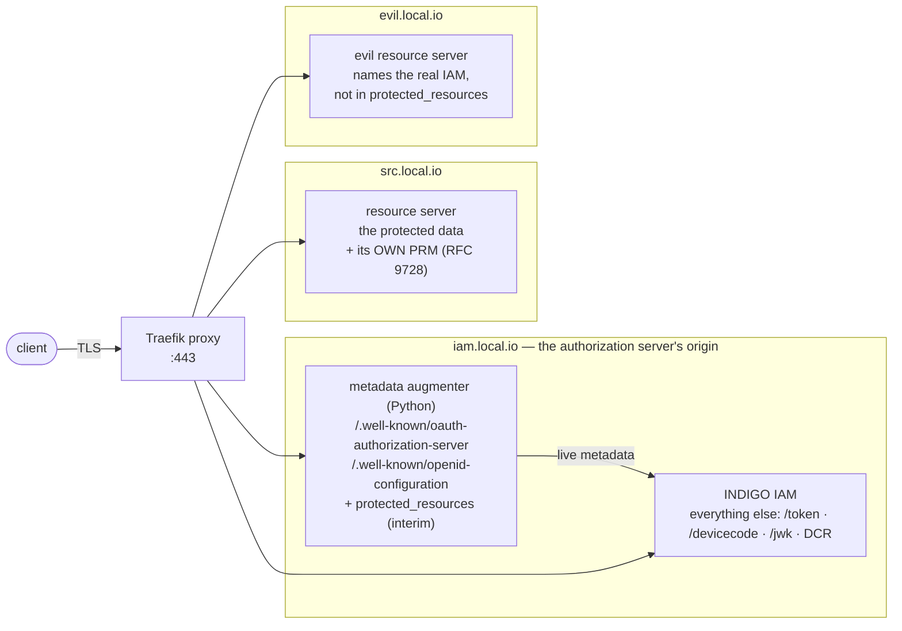

# AuthVO clients & local integration harness

Reference clients and a self-contained, `docker compose`–based test
environment for the **IVOA AuthVO bearer-token flow** — securing Virtual
Observatory data services with OAuth2/OIDC bearer tokens, using **INDIGO IAM**
as the authorization server.

This repository contains:

* two **reference client implementations** (Python and Java) of the AuthVO flow,
  which follows RFC 9728 (see §13 for what changed with
  [AuthVO issue #22](https://github.com/ivoa-std/AuthVO/issues/22)), and
* a **local integration harness** (`test-integration/`) that stands up a real
  INDIGO IAM, a metadata *augmenter* that emulates the one thing INDIGO does not
  yet publish, a single-origin Traefik proxy, a protected resource server, and an
  "evil" resource server for a negative test, plus runnable demo drivers and a
  live scenario runner.

---

## 1. Background — the problem AuthVO solves

Plain OAuth2 does not tell a client *which* resource server a freshly-issued
token may be sent to. A malicious resource server (the "evil service") can name a
**real** identity provider in its own metadata and so lure the user into
obtaining a real token for it, then capture that token.

The AuthVO direction (from the IVOA DSP *Bearer Tokens — Open Issues* deck, as
revised by issue #22) follows [RFC 9728](https://www.rfc-editor.org/rfc/rfc9728):

* The resource server's `401` returns **only a pointer** (`resource_metadata`) to
  its **own** Protected Resource Metadata (PRM) document, which it publishes at
  its own well-known URL. The pointer is untrusted; the client only accepts a PRM
  whose `resource` **covers the URL it asked for**.
* But a resource server can say anything about itself, including "my issuer is
  the real IAM". So the binding is checked **from the other side**: the
  authorization server's own RFC 8414 metadata must name the same issuer **and
  list the resource in `protected_resources`**
  ([RFC 9728 §4](https://www.rfc-editor.org/rfc/rfc9728#section-4)). Only the
  issuer can vouch for which resources it serves. If it publishes no such list
  the client refuses: **absence is a failure, not a pass.** This *resource check*
  happens before the user is asked to log in.
* The client uses the device grant and sends the matched resource as an
  [RFC 8707](https://www.rfc-editor.org/rfc/rfc8707) `resource` indicator, so a
  cooperating issuer can bind the token's `aud`. (RFC 8693 token exchange can
  narrow it further, but is optional and off by default.) The resource server
  enforces `iss`, `vo.read`, expiry and — whenever the token carries one — `aud`.

## 2. The flow

```
 1  GET the protected resource anonymously (no redirects)
    -> 401  WWW-Authenticate: Bearer resource_metadata="<PRM url>"   (UNTRUSTED pointer)
 2  GET the PRM at that pointer — the resource server's OWN RFC 9728 document —
    over HTTPS, no redirects.  ABORT unless the PRM `resource` covers the
    requested URL.
 3  RESOURCE CHECK (abort before any login).  For an issuer named in the PRM, GET
    its RFC 8414 metadata (no redirects) and require
       (a) metadata `issuer`  ==  the issuer the PRM named
       (b) `protected_resources` present AND one entry covers the requested URL
    The first listed issuer that passes both is used.  OIDC discovery is used only
    to read endpoints, never to skip (b).
 4  Obtain a client_id (preconfigured, or dynamic registration RFC 7591)
 5  Device authorization (RFC 8628): the user logs in and approves on the IAM's own
    page (the client shows the resource AND the issuer); poll the token endpoint
    sending  resource=<matched resource id>  (RFC 8707).
    [optional, off by default: RFC 8693 token exchange]
 6  Access the resource with the token (RS verifies signature/iss/scope/expiry,
    and aud when present)
 7  (refresh would re-send the same `resource` — not implemented in the reference clients)
```

**"Covered"** (steps 2 and 3b) means: equal to the identifier, or the same
scheme, host and port with a path that extends it **at a path-segment
boundary**. `https://src.local.io/vo` covers `https://src.local.io/vo/tap/async/1`
but not `https://src.local.io/vocab`; a root identifier (`https://src.local.io`)
covers its whole origin. Dot-segments are resolved first, so `/vo/../other` is not
"under" `/vo`. Both clients are tested against the same vectors
(`test-integration/tests/coverage_vectors.json`).

The token is requested for the identifier that matched in 3(b) — the most
specific one if several match — not for the dynamic deep URL the client started
from.

---

## 3. Repository layout

| Path | Role |
|------|------|
| `authvo_client.py` | Python reference client (the flow of §2) |
| `AuthVoClient.java` | Java reference client (JDK 11+, Jackson) — behaves identically |
| `pom.xml` | Java build |
| `Demo.java`, `demo.py` | Root-level copies of the simplest demo driver (`demo.py` just runs `test-integration/demo/demo.py`) |
| `test-integration/` | The runnable Docker harness (everything below lives here) |
| `test-integration/docker-compose.yml` | The whole stack behind Traefik |
| `test-integration/setup.sh` | One-shot: certs + keystore + Traefik config, brings it up, provisions |
| `test-integration/iam/iam.env` | INDIGO IAM configuration |
| `test-integration/iam/GenKeystore.java` | Generates the IAM JWK signing keystore (pure JDK) |
| `test-integration/iam/keys/keystore.jwks` | JWT signing key set, generated locally (see §7) |
| `test-integration/augmenter/` | **Metadata augmenter** (Python, stdlib): adds `protected_resources` to the IAM's metadata — an interim emulation (see §6) |
| `test-integration/augmenter/config/protected_resources.json` | The resource identifiers the augmenter publishes |
| `test-integration/traefik/traefik.yml` | Single-origin proxy + TLS |
| `test-integration/fake-rs/` | The protected resource server (Flask); serves its own PRM; also the "evil" instance |
| `test-integration/seed/provision.sh` | Provisions the IAM: vo.read scope, login users, authvo-client |
| `test-integration/demo/demo.py` | Reference driver (interactive device flow) |
| `test-integration/demo/auto_demo.py` | Non-interactive driver (auto-approves the login) |
| `test-integration/demo/human_demo.py` | Guided driver (Python): explains and pauses on every step |
| `test-integration/demo/Demo.java`, `HumanDemo.java` | The same two drivers in Java (JDK-only, single file) |
| `test-integration/demo/authvo_checks.py` | The discovery checks shared by the Python demos |
| `test-integration/tests/` | Offline unit tests and the live scenario runner (see §10) |

---

## 4. Architecture of the harness



* The **resource server** publishes its own PRM; nothing about the resource lives
  on the IAM origin any more. What ties `src.local.io` to the IAM is the IAM's
  `protected_resources` list, which the **augmenter** adds to the two
  `/.well-known` metadata documents (Traefik sends exactly those paths to it, at
  higher priority; every other IAM path goes straight to the IAM).
* The augmenter is an **interim emulation**. INDIGO IAM does not publish
  `protected_resources` yet and is not modified. To a client the augmented
  metadata is indistinguishable from native support, so the augmenter (and its
  Traefik router) can simply be deleted once INDIGO publishes the member.
* `iam.local.io`, `src.local.io` and `evil.local.io` all resolve to `127.0.0.1`
  (via `/etc/hosts`) and are served by the same Traefik instance on `:443`.

---

## 5. Prerequisites

* Docker + Docker Compose.
* Add the hostnames to `/etc/hosts` (each on its own line):

  ```
  127.0.0.1  iam.local.io src.local.io evil.local.io
  ```

  (`evil.local.io` is needed only for the negative test; the scenario runner can
  work without it, see §10.)

* Trust the generated CA (`test-integration/certs/local-ca.pem`) in your browser
  if you want to use the IAM web UI. On macOS:

  ```bash
  sudo security add-trusted-cert -d -r trustRoot \
    -k /Library/Keychains/System.keychain test-integration/certs/local-ca.pem
  ```

* Python 3 with `requests` for the Python client and demo drivers
  (`REQUESTS_CA_BUNDLE=test-integration/certs/local-ca.pem` makes the client trust
  the local CA). The Java client needs JDK 11+ and Jackson (see `pom.xml`).

> **Note on the IAM image.** The harness pins
> `indigoiam/iam-login-service:v1.10.0`. It is an `amd64` image, so it runs under
> emulation on Apple Silicon (slower first boot). Env var names and the bootstrap
> mechanism move between INDIGO releases — §7 documents exactly what v1.10.0
> needs.

---

## 6. The PRM and the metadata augmenter

Two documents carry the discovery, and **they come from different parties**:

| Document | Published by | Says | Checked in |
|----------|--------------|------|-----------|
| PRM (RFC 9728) at `https://src.local.io/.well-known/oauth-protected-resource` | the **resource server** | "I am this resource; these issuers sign my tokens" | step 2 |
| AS metadata (RFC 8414) at `https://iam.local.io/.well-known/oauth-authorization-server` | the **authorization server** | "these are the resources I serve" (`protected_resources`) | step 3 |

### 6.1 The PRM (served by `fake-rs`)

`fake-rs/app.py` builds the PRM from its environment — there is no static file:

```json
{
  "resource": "https://src.local.io",
  "authorization_servers": ["https://iam.local.io/"],
  "scopes_supported": ["vo.read"],
  "bearer_methods_supported": ["header"]
}
```

| Field | From | Meaning |
|-------|------|---------|
| `resource` | `RS_RESOURCE_ID` | The canonical id of the resource. Every protected URL must be covered by it (§2) and a token's `aud`, when present, must include it. |
| `authorization_servers` | `RS_ISSUER` | Issuer(s) the resource accepts tokens from. The client trusts one **only after** the resource check. |
| `scopes_supported` | `RS_REQUIRED_SCOPE` | Scopes the resource understands. |
| `bearer_methods_supported` | — | `header` = `Authorization: Bearer`. |

It is served at the RFC 9728 §3.1 URL: the well-known suffix is **inserted between
the host and the path** of `RS_RESOURCE_ID` (`https://src.local.io/vo` would be
published at `https://src.local.io/.well-known/oauth-protected-resource/vo`).
`RS_PRM_URL` sets the pointer in the 401 challenge; it defaults to that URL.

### 6.2 The metadata augmenter (`augmenter/app.py`)

A small stdlib-Python reverse proxy. It fetches the IAM's **live** metadata over
the internal network, adds one member, and returns everything else unchanged
(above all `issuer`):

```json
"protected_resources": ["https://src.local.io"]
```

* The list comes from `augmenter/config/protected_resources.json` and is read on
  **every request**, so an edit takes effect at once. The IAM's own metadata is
  cached for ~60 s (`AUGMENTER_CACHE_SECONDS`).
* If the IAM has no RFC 8414 document, one is derived from its OIDC discovery
  document.
* If the upstream document already contains `protected_resources`, it is left
  alone — native support wins.
* If the config file is missing or unreadable the member is **omitted**, which a
  client treats as a failure (it fails closed).

> **This is the interim emulation described in the AuthVO draft's implementation
> note. Delete the `augmenter` service and its Traefik router as soon as INDIGO IAM
> publishes `protected_resources` natively.**

### 6.3 Routing on the IAM origin (Traefik)

The augmenter answers exactly the two metadata paths, with a **higher router
priority** than the IAM, so those paths win on the shared `iam.local.io` origin:

```yaml
labels:
  - "traefik.enable=true"
  - "traefik.http.routers.augmenter.rule=Host(`iam.local.io`) && (Path(`/.well-known/oauth-authorization-server`) || Path(`/.well-known/openid-configuration`))"
  - "traefik.http.routers.augmenter.entrypoints=websecure"
  - "traefik.http.routers.augmenter.tls=true"
  - "traefik.http.routers.augmenter.priority=100"     # IAM router is priority 1
  - "traefik.http.services.augmenter.loadbalancer.server.port=8080"
```

### 6.4 The "evil" resource server

`evil.local.io` is a second `fake-rs` instance. Its 401 points at its own,
perfectly well-formed PRM, which **names the real IAM** as its authorization
server — exactly the attack — but `https://evil.local.io` is not in the IAM's
`protected_resources`. Every client must therefore abort at the resource check,
before registration or any login. Its payload reads "EVIL SERVICE" so a leak
would be obvious.

---

## 7. INDIGO IAM — required configuration & provisioning

A stock `indigoiam/iam-login-service:v1.10.0` started with the production-style
`mysql` profile does **not** come up ready out of the box. The following changes
are what make the flow work end to end. They live in `iam/iam.env` and
`docker-compose.yml`.

### 7.1 `iam/iam.env` changes

```properties
# 1. Flyway bundles migrations for several DB vendors under db/migration/{h2,mysql,...}.
#    Pin to the mysql set, or it finds two "V1" migrations and aborts at boot.
SPRING_FLYWAY_LOCATIONS=classpath:db/migration/mysql

# 2. The IAM_DB_* names are NOT honored by v1.10.0 — it falls back to embedded H2
#    and runs the MySQL migrations against it (syntax error). Drive the datasource
#    with the standard Spring Boot properties so it connects to MariaDB.
SPRING_DATASOURCE_URL=jdbc:mysql://db:3306/iam
SPRING_DATASOURCE_USERNAME=iam
SPRING_DATASOURCE_PASSWORD=pwd
SPRING_DATASOURCE_DRIVER_CLASS_NAME=com.mysql.cj.jdbc.Driver

# 3. v1.10.0 ships NO signing keystore; the app won't start without one.
#    Generate a JWK set (see 7.2) and point the IAM at it.
IAM_KEY_STORE_LOCATION=file:/keystore.jwks

# 4. Put the granted scopes INTO the JWT access token (default is false) so the
#    resource server can enforce vo.read from the token itself.
IAM_ACCESS_TOKEN_INCLUDE_SCOPE=true
```

### 7.2 Generate the JWT signing keystore

INDIGO expects a JWK **set** (JSON) whose `kid` matches `IAM_JWK_DEFAULT_KEY_ID`
(default `rsa1`). Generate one and mount it at `/keystore.jwks`:

```python
import json, base64
from cryptography.hazmat.primitives.asymmetric import rsa

def b64u(i):
    b = i.to_bytes((i.bit_length() + 7) // 8, "big")
    return base64.urlsafe_b64encode(b).rstrip(b"=").decode()

k = rsa.generate_private_key(public_exponent=65537, key_size=2048)
pub, pri = k.public_key().public_numbers(), k.private_numbers()
jwk = {"kty": "RSA", "kid": "rsa1", "use": "sig", "alg": "RS256",
       "n": b64u(pub.n), "e": b64u(pub.e), "d": b64u(pri.d),
       "p": b64u(pri.p), "q": b64u(pri.q),
       "dp": b64u(pri.dmp1), "dq": b64u(pri.dmq1), "qi": b64u(pri.iqmp)}
json.dump({"keys": [jwk]}, open("iam/keys/keystore.jwks", "w"), indent=2)
```

```yaml
# docker-compose.yml (iam service)
volumes:
  - ./iam/keys/keystore.jwks:/keystore.jwks:ro
```

### 7.3 Provision the empty database

Under the `mysql` profile the schema is created but **no seed data** is loaded —
no users, no clients, the custom `vo.read` scope does not exist. `setup.sh` runs
[`seed/provision.sh`](test-integration/seed/provision.sh) to do all of this
automatically (idempotently); the SQL below is what that script does, for
reference.

**a) A login user** (the device grant needs a real account). INDIGO stores a
bcrypt password and uses a `DTYPE='IamUserInfo'` discriminator on `iam_user_info`:

```sql
INSERT INTO iam_authority(auth) VALUES ('ROLE_USER'),('ROLE_ADMIN');  -- if absent
INSERT INTO iam_user_info(EMAIL,EMAILVERIFIED,FAMILYNAME,GIVENNAME,DTYPE)
  VALUES ('vouser@local.io',1,'User','Vo','IamUserInfo');
INSERT INTO iam_account(active,CREATIONTIME,LASTUPDATETIME,PASSWORD,USERNAME,UUID,user_info_id,provisioned)
  VALUES (1,NOW(),NOW(),'<bcrypt-hash>','vouser','<uuid>',LAST_INSERT_ID(),0);
-- then link the account to ROLE_USER in iam_account_authority
```

Generate the bcrypt hash with `htpasswd -bnBC 10 "" <password>` (normalize the
`$2y$` prefix to `$2a$`). The harness creates `admin`/`password` (admin) and
`vouser`/`vouser` (user).

**b) The `vo.read` system scope:**

```sql
INSERT INTO system_scope(scope,description,restricted,default_scope,structured)
  VALUES ('vo.read','Read access to VO protected resources',0,0,0);
```

**c) An OAuth client** — only needed by `demo.py`/`auto_demo.py` and the scenario
runner, which read a preconfigured `client_id` from `seed/client_id`.
`human_demo.py` registers its own client at runtime instead. To create a friendly
`client_id` (DCR generates a random one), register via DCR then rename it and add
the token-exchange grant (which the clients only use when token exchange is
switched on, §7.4):

```sql
UPDATE client_details SET client_id='authvo-client' WHERE client_id='<generated>';
INSERT INTO client_grant_type(owner_id, grant_type)
  SELECT id,'urn:ietf:params:oauth:grant-type:token-exchange'
  FROM client_details WHERE client_id='authvo-client';
```

### 7.4 Audience binding, and the token-exchange restriction

The clients ask for audience binding with the RFC 8707 **`resource`** parameter on
the device-grant token request, and stop there: RFC 8693 token exchange is
**optional and off by default** (`AuthVoClient(token_exchange=True)`,
`AUTHVO_TOKEN_EXCHANGE=1`, or `--token-exchange` on the demos). Whether the JWT
that comes back carries an `aud` is up to the issuer — which is why the resource
server enforces `aud` **whenever the token has one** (it must include the
resource) without *requiring* one; the signature, `iss`, `vo.read` and expiry are
always checked.

> **Observed with the pinned INDIGO IAM v1.10.0:** it *accepts* the `resource`
> parameter but **ignores it** — the access token has no `aud` (the clients log
> `aud=<absent>`). So against INDIGO the flow works, but the token is not
> audience-bound unless the **optional token exchange** is used: with it on
> (scenario 1c in §10) the exchanged token carries `aud=https://src.local.io`.
> Without an `aud` the resource server cannot tell a token minted for it from one
> minted for another service this issuer serves, so deployments that want replay
> protection against INDIGO should enable the exchange (or an issuer that honours
> RFC 8707). Clients log the token's `aud` for information only and never fail
on it. (Earlier versions of `human_demo` used INDIGO's non-standard `aud` request
parameter; that is gone — the clients send `resource` only.)

`DefaultClientRegistrationService` hard-codes
`FORBIDDEN_GRANT_TYPES_FOR_ANONYMOUS` to include `token-exchange` and
`password`. A **self-registered** (RFC 7591) client therefore **cannot** request
the token-exchange grant — there is no env toggle for this. Consequently:

* By default every client, including a purely self-registered one, completes the
  flow with the `resource` indicator alone, and dynamic registration asks only for
  the device-code grant.
* To use token exchange as well, use a **preconfigured** client that was given the
  grant (`provision.sh` does this for `authvo-client`) and switch it on.

---

## 8. TLS / certificates

`setup.sh` generates a local CA and a leaf certificate for `iam.local.io`,
`src.local.io` and `evil.local.io`. The CA is created once and kept; only the
**leaf** is re-issued if it lacks a name (e.g. it predates `evil.local.io`), so a
CA you already trust stays valid. Modern OpenSSL 3
(used by Python 3.11+) **rejects a CA without the proper X.509 extensions**
(`CA cert does not include key usage extension`), so the CA and leaf are issued
with explicit extensions:

```bash
# CA
openssl req -x509 -nodes -newkey rsa:2048 -days 825 \
  -keyout certs/local-ca.key -out certs/local-ca.pem -subj "/CN=AuthVO Local Test CA" \
  -addext "basicConstraints=critical,CA:TRUE" \
  -addext "keyUsage=critical,keyCertSign,cRLSign"

# leaf extensions (certs/san.ext)
basicConstraints = CA:FALSE
keyUsage = digitalSignature, keyEncipherment
extendedKeyUsage = serverAuth
subjectAltName = DNS:iam.local.io, DNS:src.local.io, DNS:evil.local.io
```

---

## 9. The resource server (`fake-rs/`)

A small Flask service standing in for a TAP/DataLink/SODA endpoint.

* Unauthenticated `GET /vo-resource` (or `GET /datalink/download/...`) →
  `401` with `WWW-Authenticate: Bearer resource_metadata="<its own PRM>"`.
* `GET /.well-known/oauth-protected-resource` → its **own PRM** (§6.1).
* With a Bearer token it verifies, before returning anything: signature against
  the IAM JWKS, `iss == IAM`, scope contains **`vo.read`**, not expired, and — if
  the token carries an `aud` — that it **includes the resource's own id**.
* Valid → `200` with the payload (`protected_resource.txt`).
* Missing scope → `403 insufficient_scope`; bad/expired/wrong-aud → `401`.
* With `RS_TEST_FAULTS=1` (on for the harness's `src` instance) it also serves two
  deliberately broken discovery set-ups used by the negative scenarios:
  `/faults/prm-not-covering/vo-resource` (its PRM describes a different resource)
  and `/faults/prm-redirect/vo-resource` (its PRM URL redirects to a good PRM).

The validation logic is covered by `tests/test_fake_rs.py`: the six cases — valid,
wrong audience, missing scope, rogue issuer, expired, unauthenticated — plus the
PRM endpoint, `aud` present/absent, and the fixtures.

Two harness fixes worth noting:

* The pinned **PyJWT 2.7.0** `PyJWKClient` fetches the JWKS via `urllib`, which
  ignores the app's `requests` CA bundle. Point urllib's default TLS context at
  the CA with `SSL_CERT_FILE=/certs/local-ca.pem` on the service.
* The payload file is mounted (`./fake-rs/protected_resource.txt`) so editing it
  needs only a `docker compose up -d resource`, not an image rebuild.

---

## 10. Running it

```bash
cd test-integration
./setup.sh            # certs + keystore + Traefik config + up + provision (idempotent)
```

`setup.sh` reproduces the whole working stack in one shot: it generates the CA and
leaf certs (with the X.509 extensions OpenSSL 3 requires, §8) and the IAM signing
keystore (§7.2), starts the stack, then runs `seed/provision.sh` to create the
`vo.read` scope, the login users (`admin`/`password`, `vouser`/`vouser`) and the
`authvo-client` (§7.3). It is safe to re-run.

> **A `docker-compose.override.yml` is merged automatically.** If you keep one in
> `test-integration/` (say, to remap the proxy to `:8443` so the stack can coexist
> with another one holding `:443`), `docker compose` picks it up without being
> asked — but the scripts, the demos and the scenario runner all use
> `https://iam.local.io/` on `:443`. Skip the override with
> `COMPOSE_FILE=docker-compose.yml ./setup.sh` (and for any `docker compose`
> command), or rename the file while you don't need it. While it waits for the IAM,
> `provision.sh` prints a **diagnosis** every ~30 s (what each URL answers, which
> port Traefik is really on, whether the IAM was OOM-killed, …), so a stall says why.

### The demo drivers

Run any of them from `test-integration/demo/`:

```bash
# Reference driver — you complete the device login in a browser.
python demo.py --resource https://src.local.io/vo-resource \
  --cacert ../certs/local-ca.pem --client-id-file ../seed/client_id

# Non-interactive — auto-approves the device login as the given user.
python auto_demo.py --username vouser --password vouser

# Guided — explains and pauses on every step (including WHY each check exists);
# the client self-registers (RFC 7591), you log in and approve on the IAM's page.
python human_demo.py

# Same guided flow in Java, no build step (JDK 11+):
java HumanDemo.java
```

Add `--token-exchange` to `demo.py`/`auto_demo.py` to also run RFC 8693 exchange.
On success the resource returns the protected payload (an ASCII galaxy here).

### The reference clients

```bash
export REQUESTS_CA_BUNDLE=test-integration/certs/local-ca.pem
AUTHVO_CLIENT_ID=$(cat test-integration/seed/client_id) \
  python authvo_client.py https://src.local.io/vo-resource

# Java: needs Jackson (core, annotations, databind) on the classpath, see pom.xml.
javac -d out -cp "$JACKSON" AuthVoClient.java
keytool -importcert -noprompt -alias authvo-local -file test-integration/certs/local-ca.pem \
  -keystore ca.jks -storepass changeit
AUTHVO_CLIENT_ID=$(cat test-integration/seed/client_id) \
  java -Djavax.net.ssl.trustStore=ca.jks -Djavax.net.ssl.trustStorePassword=changeit \
       -cp "out:$JACKSON" org.ivoa.authvo.AuthVoClient https://src.local.io/vo-resource
```

Both exit `0` only if the resource returns `200`, `1` on a failed check / network
error / any other status. Set `AUTHVO_TOKEN_EXCHANGE=1` to also exchange the token.

### Tests

*Offline* (no Docker needed):

```bash
pip install requests flask "pyjwt[crypto]==2.7.0"
python -m unittest discover -s test-integration/tests -p "test_*.py" -v

# Java: the client (steps 1-3, stubbed HTTP) and the demos' helper copies
javac -d out -cp "$JACKSON" AuthVoClient.java test-integration/tests/ClientOfflineTest.java
java  -cp "out:$JACKSON" org.ivoa.authvo.ClientOfflineTest test-integration/tests/coverage_vectors.json
javac -d out2 test-integration/demo/Demo.java test-integration/demo/HumanDemo.java test-integration/tests/DemoHelpersTest.java
java  -cp out2 DemoHelpersTest test-integration/tests/coverage_vectors.json
```

*Live scenarios* — the real clients against the running stack, with the device
login auto-approved:

```bash
python test-integration/tests/run_scenarios.py --java-cp "$JACKSON"
```

| # | Scenario | Expected |
|---|----------|----------|
| 0 | preflight | the stack serves the PRM, the augmented metadata, no PRM sidecar |
| 1 | happy path (1: preconfigured client, 1b: dynamic registration, 1c: with the optional token exchange on), Python and Java | protected payload returned (1c: the exchanged token carries `aud`) |
| 2 | evil resource server (`evil.local.io`) | abort at the resource check, before any login |
| 3 | `protected_resources` removed from the augmenter config | abort at the resource check |
| 4 | PRM `resource` does not cover the requested URL | abort at step 2 |
| 5 | the PRM URL redirects | abort — redirects are never followed |
| 6 | resource server's token-validation cases | unit tests pass |

Every abort scenario also asserts the client stopped **before** registration and
the device grant. If `evil.local.io` is not in `/etc/hosts` the runner maps it for
the client processes only.

---

## 11. Troubleshooting

| Symptom | Cause / fix |
|---------|-------------|
| IAM exits: *Found more than one migration with version 1* | Flyway scanning both vendor dirs — set `SPRING_FLYWAY_LOCATIONS=classpath:db/migration/mysql`. |
| IAM exits: H2 syntax error on `token_value(767)` | Datasource fell back to H2 — set the `SPRING_DATASOURCE_*` properties. |
| IAM exits: *Key Set resource could not be read: keystore.jwks* | No signing keystore — generate one (§7.2) and set `IAM_KEY_STORE_LOCATION`. |
| Client aborts: *check (b): the issuer publishes no protected_resources* | The augmenter isn't answering the metadata paths (Traefik hasn't registered it — retry or restart the proxy) or its config is empty. Check `curl --cacert test-integration/certs/local-ca.pem https://iam.local.io/.well-known/oauth-authorization-server \| jq .protected_resources` (§6.2). |
| Client aborts: *STEP 2 FAILED … does not cover the requested URL* | The PRM's `resource` (`RS_RESOURCE_ID`) doesn't cover the URL you asked for (§2). |
| Client aborts: *refusing to follow redirects* | A discovery URL answered 3xx. Clients never follow redirects; fix the URL (the PRM pointer, the issuer in the PRM). |
| Client aborts: *check (a): metadata issuer … != the issuer named by the PRM* | `RS_ISSUER` and the IAM's `IAM_ISSUER` differ (mind the trailing slash). |
| `augmenter` returns `502` | The IAM isn't up yet (or is down); it proxies the IAM's live metadata. |
| `evil.local.io` doesn't resolve / TLS error for it | Add it to `/etc/hosts` (§5); re-run `./setup.sh` so the leaf certificate covers it. |
| Client TLS: *CA cert does not include key usage extension* | Regenerate certs with the X.509 extensions (§8). |
| RS `401 invalid_token`, `PyJWKClientConnectionError` | JWKS fetch can't verify TLS — set `SSL_CERT_FILE` on the resource (§9). |
| RS `403 insufficient_scope` | Token has no `scope` claim — set `IAM_ACCESS_TOKEN_INCLUDE_SCOPE=true`. |
| DCR: *Grant type not allowed: ...token-exchange* | Self-registration can't request token-exchange. It is off by default now; leave it off or use a preconfigured client (§7.4). |
| `./setup.sh` sits at *waiting for IAM* although `docker compose logs iam` says *Started IamLoginService* | The proxy is published on a port other than 443 — typically because a `docker-compose.override.yml` remapping it (e.g. `8443:443`) was merged automatically. `provision.sh` now says so in its diagnosis. Re-run with `COMPOSE_FILE=docker-compose.yml ./setup.sh` (§10). |
| `curl: (22) … 404` on client registration, or every IAM path (even `/login`) answers a bare `404 page not found` while the discovery document works | Traefik has not registered the IAM's router (a start-up race when the proxy and the IAM are recreated together; the discovery document is a different router, served by the augmenter). `docker compose restart proxy`, then re-run `./setup.sh`. `provision.sh` now waits for `/login` as well and retries registration. |
| `seed/provision.sh` times out after ~7.5 min with `IAM did not come up`, later demos get `404` instead of `401` | Host port 443 is already taken by something else, so the `proxy` (Traefik) service fails to start (`Bind for 0.0.0.0:443 failed: port is already allocated`) while the rest of the stack comes up fine — nothing is actually fronting `iam.local.io`/`src.local.io`, so discovery never succeeds and unrelated requests land wherever else 443 is bound. Check with `docker ps --format "{{.Names}}\t{{.Ports}}" \| grep 443` / `sudo lsof -iTCP:443 -sTCP:LISTEN`, free the port (or remap the `proxy` service's port and the IAM's `IAM_ISSUER`/`IAM_BASE_URL` via a `docker-compose.override.yml`), then re-run `./setup.sh`. |

---

## 12. Security notes

* This harness uses self-signed certs, throwaway passwords, and a public
  (`token_endpoint_auth_method: none`) client. It is for **local testing only**.
* The security argument rests on the **resource check** (step 3): the issuer's own
  metadata must name the same issuer *and* list the resource, and an absent list is
  a failure. It does **not** rest on where any document is hosted. (The augmenter
  sits on the IAM origin only because that is where the IAM's metadata is served;
  being interim, it is the part to delete when INDIGO publishes the member.)
* No discovery request, and no request carrying a bearer token, ever follows a
  redirect.
* The resource server validates the token server-side (signature, `iss`, scope,
  expiry, and `aud` when present). The client's checks are what stop it from
  sending the user to log in, and a token to be minted, for a spoofed resource in
  the first place.

---

## 13. Changes for AuthVO issue #22

The IVOA draft changed after [issue #22](https://github.com/ivoa-std/AuthVO/issues/22):
the old design was not RFC 9728-conformant. The PRM was served from the **IAM's**
origin by an nginx "sidecar", and the client's *domain-proxy check* required the
sidecar and the issuer to share an origin. RFC 9728 says the PRM belongs to the
**resource server**; the binding between resource and authorization server comes
from the authorization server's own `protected_resources` metadata member.

### Client flow: old step → new step

| Old (domain-proxy design) | New |
|---------------------------|-----|
| 1 GET the resource anonymously | **1** probe — same, no redirects (made explicit in Python) |
| 2 401 → sidecar pointer | **1** — the pointer is extracted as part of the probe (still untrusted) |
| 3 GET the sidecar **at the IAM** | **2** GET the PRM published by the **resource server** (HTTPS, no redirects) |
| 4(a) domain-proxy gate (a): sidecar origin == issuer origin | **removed.** Replaced by check (a) of step 3: the issuer's RFC 8414 metadata names the issuer the PRM named |
| 4(b) gate (b): the resource is in the **sidecar's** list | split in two: **2** the PRM `resource` covers the URL, and **3(b)** the **issuer's** `protected_resources` covers it (reading `protected_resources` from the PRM is gone) |
| 5 GET AS metadata (RFC 8414, then OIDC) | merged into **3**: the RFC 8414 document is where the check is made; OIDC discovery only reads missing endpoints, never skips (b) |
| 6 dynamic registration | **4** — unchanged (asks for the token-exchange grant only if exchange is on) |
| 7 device authorization, 8 prompt the user, 9 poll the token endpoint | **5** — now sends `resource=<matched id>` (RFC 8707) and shows the resource *and* the issuer; no INDIGO `aud` parameter |
| 10 token exchange (RFC 8693) | **5d**, **optional, off by default** |
| 11 access | **6** — no redirects, `aud` checked by the RS only when present |
| 12 refresh | **7** — would re-send the same `resource`; not implemented |

Code names follow: `_step4_domain_proxy_check` → `_step3_resource_check` (the AS-metadata
fetch is merged into it), `_step3_fetch_sidecar` → `_step2_prm`; the same in
`AuthVoClient.java`.

### Harness

| Before | After |
|--------|-------|
| `prm-sidecar` (nginx) + its Traefik router on `iam.local.io` | **removed** |
| PRM at `https://iam.local.io/.well-known/oauth-protected-resource` | PRM served by **fake-rs** at `https://src.local.io/.well-known/oauth-protected-resource`; `RS_PRM_URL` points there |
| IAM metadata exactly as INDIGO publishes it | served through the **augmenter**, which adds `protected_resources` (interim emulation; delete when INDIGO supports the member) |
| `fake-rs` requires `aud == its id` | checks `aud` **when present**; token exchange no longer needed |
| — | **evil** resource server on `evil.local.io` + negative scenarios; `evil.local.io` in the cert SANs and `/etc/hosts` |
| — | offline tests and the live scenario runner (`test-integration/tests/`) |
